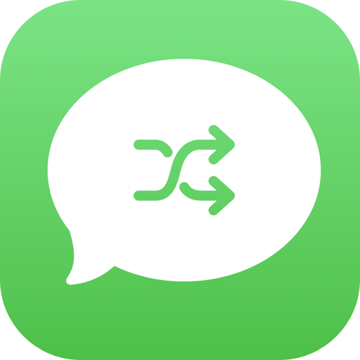
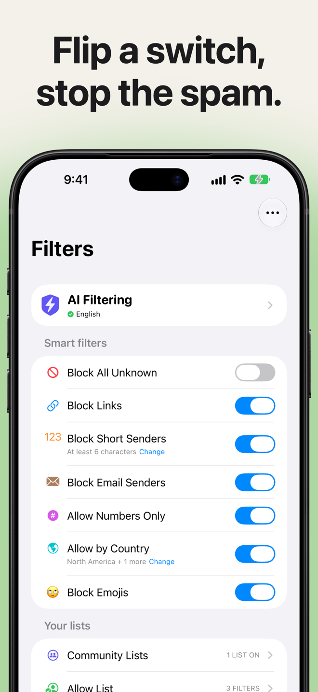
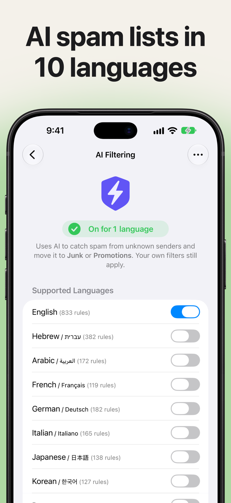
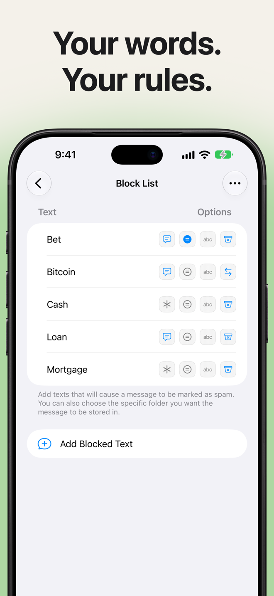
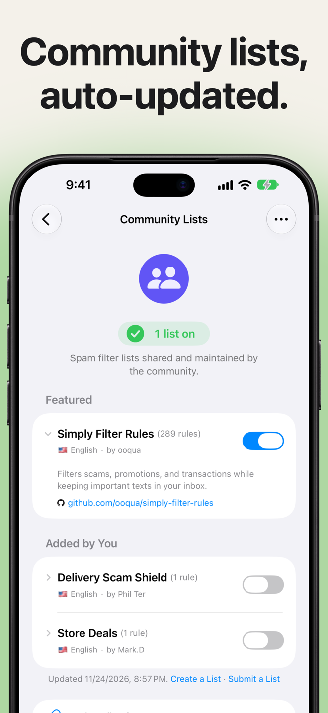
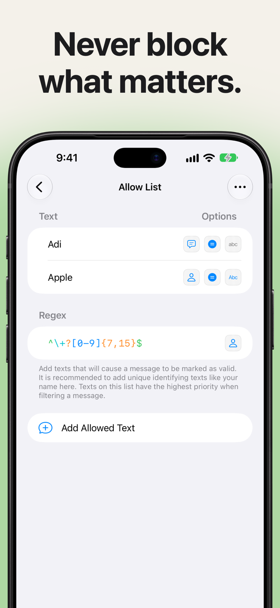
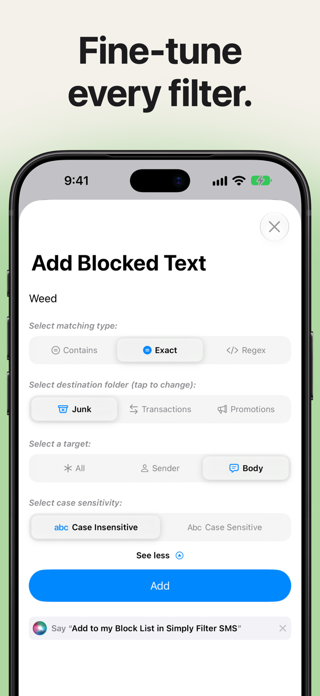
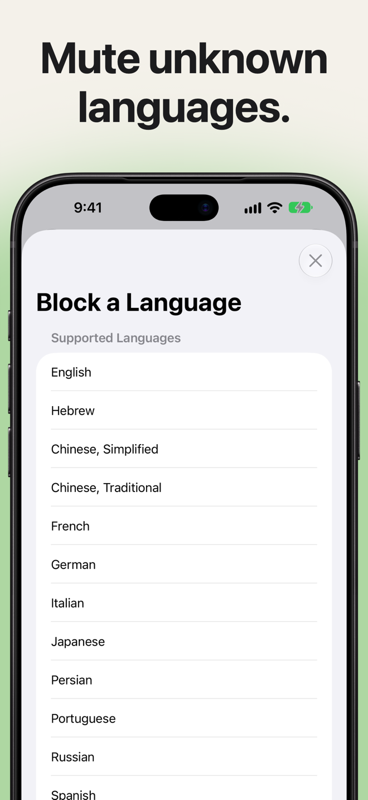
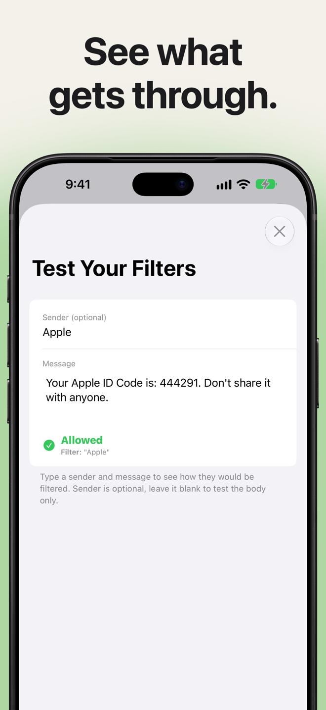
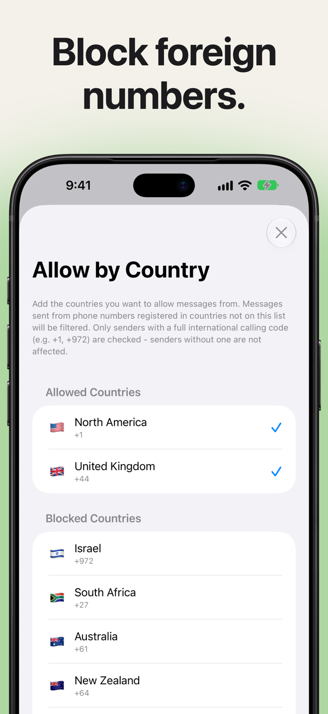

  <a href="https://apps.apple.com/us/app/simply-filter-sms/id1603222959">
    <picture>
      <source media="(prefers-color-scheme: dark)" srcset="docs/images/logo-dark.png">
      
    </picture>
  </a>
  <h1>Simply Filter SMS</h1>
  
<b>Spam texts, simply filtered.</b>

  
A private, free and open-source text message filter for iPhone and iPad.

  

    
  

  

    <a href="https://adibendahan.github.io/SimplyFilterSMS-iOS/support/">Support</a> ·
    <a href="https://adibendahan.github.io/SimplyFilterSMS-iOS/">Community Lists</a> ·
    <a href="https://adibendahan.github.io/SimplyFilterSMS-iOS/privacy/">Privacy</a>
  

  

    
    
    
  

  
  
  
  

## Features

- **Your own filters** — block or allow by keyword or regex, and pick the folder: Junk, Transactions or Promotions.
- **AI Filtering** — spam lists for 10 languages that update on their own.
- **Community Lists** — subscribe to lists others share, or [publish your own](https://adibendahan.github.io/SimplyFilterSMS-iOS/).
- **Smart Filters** — catch links, emails, emojis, short senders, foreign languages and foreign numbers with a switch.
- **Test Your Filters** — type a message and see where it lands and why.
- **Siri, Shortcuts & Spotlight** — manage and find filters without opening the app.
- **iCloud sync, export & import** — your filters on every device, and easy to share.

Available in 11 languages, built for iPhone and iPad, with full VoiceOver, Voice Control, Dynamic Type and Reduce Motion support.

## Private by design

Messages are filtered on your device, and the app collects no data. Your filters sync only through your own iCloud. The only message that ever leaves your phone is one you choose to report.

Free forever, with an optional tip jar.

## More screenshots

  
  
  
  
  

## Help

Setup steps and answers to common questions are on the [support page](https://adibendahan.github.io/SimplyFilterSMS-iOS/support/).

## Building from source

Open `Simply Filter SMS.xcodeproj` in Xcode 27 or later and build. Requires iOS 17 or later.

## Contributing

Pull requests are welcome. Open them against `develop`.

## License

[MIT](LICENSE) © 2026 Adi Ben-Dahan.

