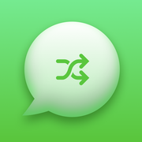
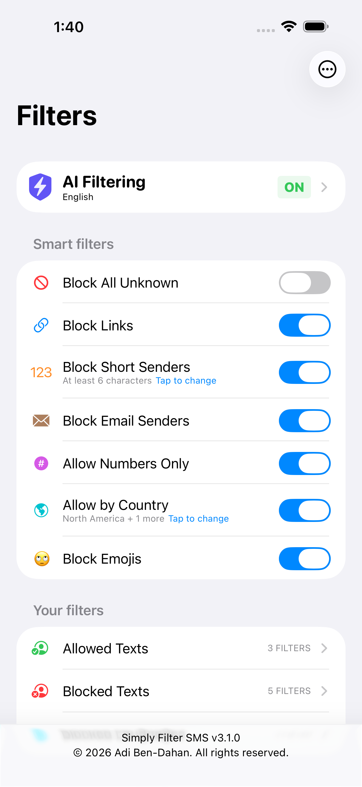
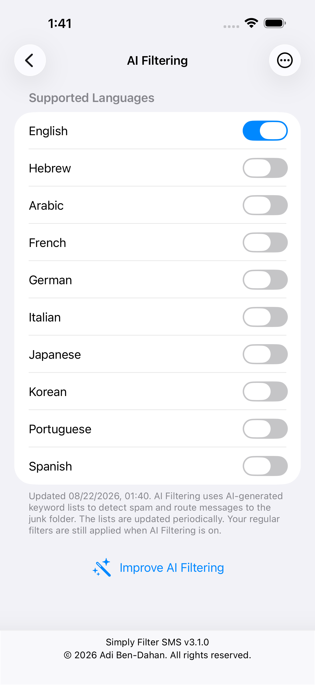
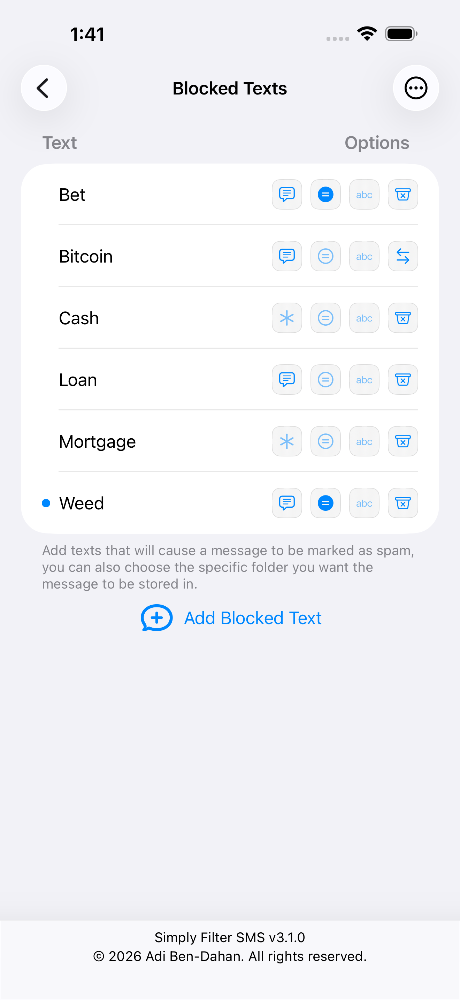
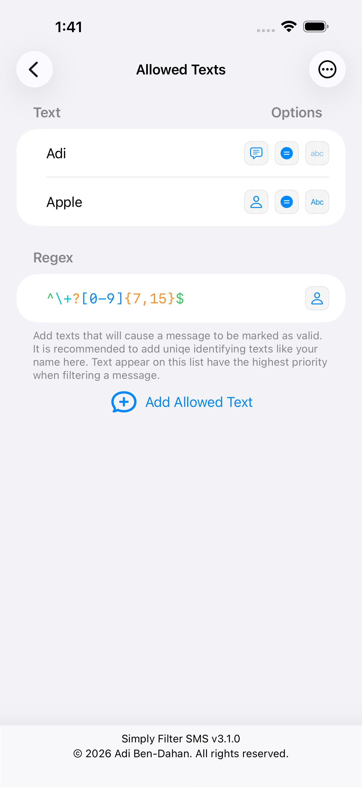
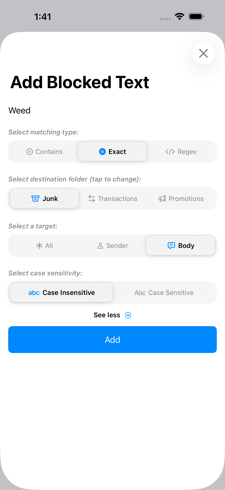
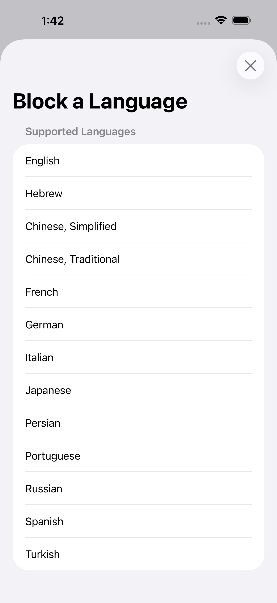
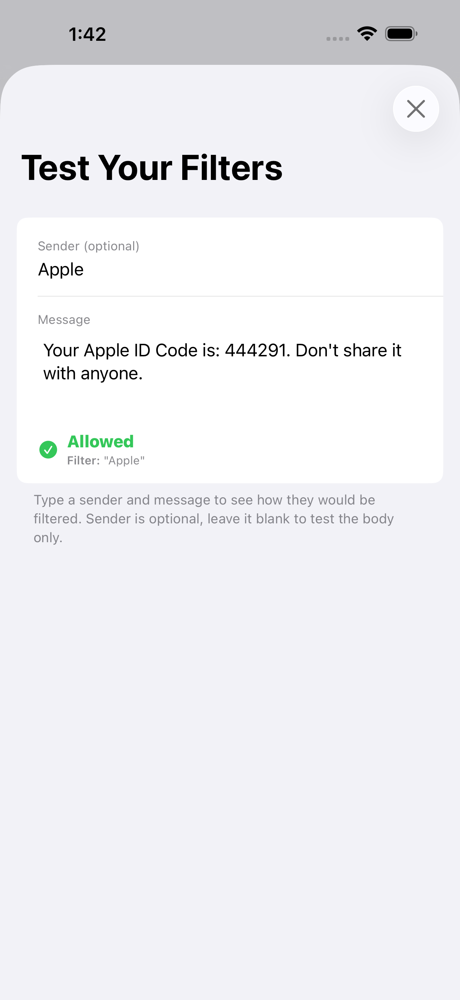
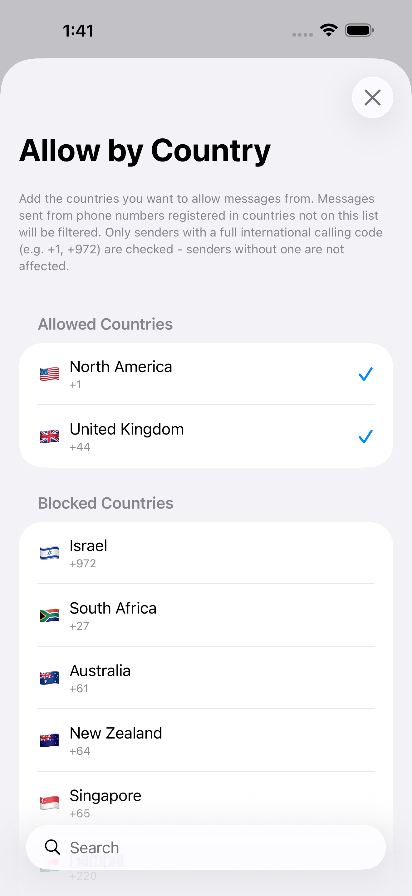

  
  <h1>Simply Filter SMS</h1>
  

    <b>Filter text messages from unknown senders using keywords, regex, and AI</b>
  

   
   
   

[![Contributors][contributors-shield]][contributors-url]
[![Forks][forks-shield]][forks-url]
[![Stargazers][stars-shield]][stars-url]
[![Issues][issues-shield]][issues-url]
[![MIT License][license-shield]][license-url]

Simply Filter SMS is a private, free and fast way to filter out spam text messages on iPhone and iPad.

## Download

### iOS

Requires iOS 17 or later.

## Features

### User Defined Filters
Add keyword or regex filters to allow or deny any specific text with full control over matching rules.

### Regex Filters
Create powerful pattern-matching filters using regular expressions for precise, flexible filtering.

### AI Filtering
AI-built filter lists for 10 languages: English, Hebrew, Spanish, French, German, Italian, Portuguese, Arabic, Japanese and Korean. The lists update automatically.

### Smart Filters
Easily filter messages from short/email/all unknown senders, containing links or emojis, or allow senders with phone numbers only.

### Trusted Countries
Automatically allow messages from specific countries by phone number prefix.

### Block Languages
Easily block all text messages in any specific language(s).

### Test Your Filters
Type a sender and a message and see right away where it would go, and which filter or rule decided it.

### Export & Import Filters
Share your filters with a friend: export them to a file and import it on any device.

### iCloud Sync
Your filters and settings sync across your devices through your own iCloud account.

### Report Messages
Report a message as junk or not junk right from the Messages app, to help improve the AI Filtering lists.

### Accent Color
Pick an accent color for the app's buttons and icons.

### Accessibility
Fully usable with VoiceOver and Voice Control, with Dynamic Type and Reduce Motion support.

## Why choose Simply Filter SMS?

### Private
Simply Filter SMS does not collect any data whatsoever. Messages are filtered on your device, and your filters sync only through your own iCloud. The only message that ever leaves your device is one you choose to report.

### Free
Simply Filter SMS is free forever. An optional tip jar is available to support development.

### Fast
The app is primarily a host of rules that integrates with iOS in a native, lightweight way, making the filtering efficient and fast.

### Open Source
The source code is published under the permissive MIT license.

### Modern
Simply Filter SMS is written in Apple's latest programming paradigm SwiftUI.

## Screenshots

## FAQ

#### ***Why aren't my messages being filtered?***

Usually one of these:

* Simply Filter SMS isn't selected as the filter in iOS Settings.
* The thread is **iMessage** (blue bubbles), not SMS. Apple doesn't let any app filter those.
* The sender is in **Contacts**. iOS skips filtering for them.

On the home screen, tap the ••• button at the top right, then **Filter Tools**, then **Test Your Filters**, and paste the sender and message. The test runs in the app even when filtering is off, so it can show filtered while Messages still delivers. If Simply Filter SMS is enabled in iOS Settings and the test still says it should have been filtered, email me.

#### ***What about iMessages and messages from my contacts?***

Apple does not expose those messages to any developer. They remain completely private.

#### ***How do I test my filters?***

On the home screen, tap the ••• button at the top right, then **Filter Tools**, then **Test Your Filters**. Type a sender and message. The result updates as you type. Leave the sender blank to test the body only.

#### ***How does message filtering work?***

When you get an SMS from a number that isn't in Contacts, Simply Filter SMS checks it in this order:

* **Allowed Texts** always get through.
* **Blocked Texts**, blocked languages, Smart Filters, Trusted Countries, and **AI Filtering** can send it to Junk, Transactions, or Promotions.
* If nothing matches, the message is delivered normally.

iMessage and senders in Contacts are never sent to the app.

#### ***What are Smart Filters?***

**Smart Filters** on the home screen catch common spam: links, emails, emojis, short senders, numbers-only senders, or all unknown senders. They work together with your own filters. **Block All Unknown** is the strongest and turns the other Smart Filters off.

#### ***What are Trusted Countries?***

**Allow by Country** lets through SMS from numbers with a country code you choose, such as +1 or +972. Senders from other countries are filtered. Numbers without a country code are not checked.

#### ***How does AI Filtering work?***

AI Filtering uses AI-generated keyword lists to detect spam and route messages to the Junk, Transactions or Promotions folder. The lists are updated periodically. Your regular filters are still applied when AI Filtering is on.

#### ***How do I help improve AI Filtering?***

On the home screen, tap the ••• button at the top right, then **Filter Tools**. **Report Message** sends a message from this app. **Improve AI Filtering** turns on reporting from a thread in Messages. Reports train the AI lists. Filtering on your device still happens locally.

#### ***Where are the filtered messages?***

When a text message is tagged as junk, it will still be available for reading in the Messages app under the Junk folder.

#### ***What's the difference between Junk/Transactions/Promotions folders?***

Not much. You can filter any word to any folder. Those folders are not customizable in any way. Only messages filtered to the Junk folder will be delivered silently.

#### ***Are my messages exposed to the app developer?***

No. Simply Filter SMS doesn't collect any information, and every message is processed on your device. A message is never sent anywhere automatically. The only exception is when you choose to report a specific message yourself: only that message is sent, and only because you tapped Report.

#### ***Can I share my filters?***

On the home screen, tap the ••• button at the top right, then **Filter Tools**, then **Export Filters**, and send the file. On the other device, use **Import Filters** to add them. Filters that already exist there are skipped. Nothing is overwritten or deleted.

## Building from source

Just open the project in Xcode and build (Xcode 27 or later).

## Contributing

Simply Filter SMS is open for pull-request business.

## License

[MIT](https://github.com/adibendahan/SimplyFilterSMS-iOS/blob/main/LICENSE) 2026 © Adi Ben-Dahan. All rights reserved.

[contributors-shield]: https://img.shields.io/github/contributors/adibendahan/SimplyFilterSMS-iOS?style=for-the-badge
[contributors-url]: https://github.com/adibendahan/SimplyFilterSMS-iOS/graphs/contributors
[forks-shield]: https://img.shields.io/github/forks/adibendahan/SimplyFilterSMS-iOS?style=for-the-badge
[forks-url]: https://github.com/adibendahan/SimplyFilterSMS-iOS/network/members
[stars-shield]: https://img.shields.io/github/stars/adibendahan/SimplyFilterSMS-iOS?style=for-the-badge
[stars-url]: https://github.com/adibendahan/SimplyFilterSMS-iOS/stargazers
[issues-shield]: https://img.shields.io/github/issues/adibendahan/SimplyFilterSMS-iOS?style=for-the-badge
[issues-url]: https://github.com/adibendahan/SimplyFilterSMS-iOS/issues
[license-shield]: https://img.shields.io/github/license/adibendahan/SimplyFilterSMS-iOS?style=for-the-badge
[license-url]: https://github.com/adibendahan/SimplyFilterSMS-iOS/blob/main/LICENSE
